<picture>
  <source media="(prefers-color-scheme: dark)" srcset="https://raw.githubusercontent.com/gregdotca/gregdotca/cards/summary-dark.svg">
  
</picture>
<picture>
  <source media="(prefers-color-scheme: dark)" srcset="https://raw.githubusercontent.com/gregdotca/gregdotca/cards/languages-dark.svg">
  
</picture>

<picture>
  <source media="(prefers-color-scheme: dark)" srcset="https://raw.githubusercontent.com/gregdotca/gregdotca/cards/contributions-dark.svg">
  
</picture>
<picture>
  <source media="(prefers-color-scheme: dark)" srcset="https://raw.githubusercontent.com/gregdotca/gregdotca/cards/weekly-dark.svg">
  
</picture>

Hello, and welcome to my personal GitHub profile!

You'll find a few of my projects pinned below, along with a handful of tools and some personal code snippets. Some of my work also lives under the [DomainMOD](https://github.com/domainmod) and [AI Code Rating](https://github.com/ai-code-rating) organizations.

For more information about my GitHub projects, head on over to [greg.ca/projects/](https://greg.ca/projects/).

Best Regards,

Greg Chetcuti

Email: [greg@greg.ca](mailto:greg@greg.ca), [greg@chetcuti.com](mailto:greg@chetcuti.com)  
GitHub: [gregdotca](https://github.com/gregdotca/)  
Mastodon: *(inactive)* ~~@greg@greg.ca~~  
Matrix: [@greg:greg.ca](https://matrix.to/#/@greg:greg.ca)  
Nostr: greg@greg.ca  
Personal API: [Send Push and Telegram messages](https://greg.ca/api/)  
Pigeon (Carrier): On hold. Training going poorly.  
Resume: [gregchetcuti.com](https://gregchetcuti.com/)  
Social Media (rarely used): [Bluesky](https://bsky.app/profile/greg.ca), [Facebook](https://www.facebook.com/gregjch/), [LinkedIn](https://www.linkedin.com/in/gregchetcuti/), [X](https://x.com/gregchetcuti/)
